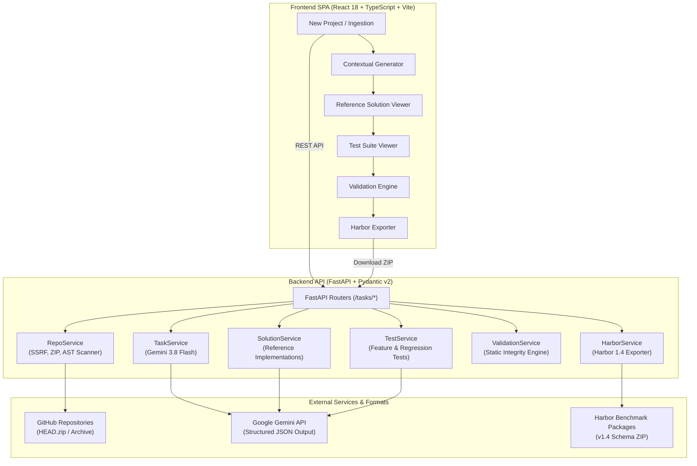

# 🏭 Coding Task Factory
## AI Coding Agent Benchmark Task & Dataset Generation Platform
### Innodata AI Hackathon 2026 – Track 1: Coding Task Factory

---

## 🎯 1. Project Purpose & Overview

**Coding Task Factory** is an automated, reusable dataset and benchmark generation platform that converts real-world software repositories into realistic, reproducible, and testable feature-development tasks designed to evaluate AI coding agents.

> **Core Philosophy**: Coding Task Factory is **NOT** an AI chatbot that answers coding questions, nor is it currently an active live-agent execution runner. Its purpose is to function as a **Task Factory & Benchmark Dataset Generator**: it ingests production codebases and produces complete, verifiable evaluation packages compatible with the **[Harbor](https://harborframework.com/)** evaluation specification.

Every generated evaluation package contains:
1. **Repository-Grounded Task Specification**: Realistic feature descriptions, architectural context, actionable requirements, and concrete acceptance criteria.
2. **Repository Version Pinning**: Exact starting repository commit SHA and repository snapshot reference.
3. **Canonical Reference Solution**: Full, production-ready implementation diffs (`create` and `modify` file operations) with architectural rationale and verification steps to establish task solvability (oracle).
4. **Dual-Layer Test Suite**: Distinct feature tests (verifying acceptance criteria) and regression tests (verifying existing codebase functionality remains intact).
5. **Static Validation & Integrity Verification**: 5-gate integrity checks verifying non-colliding file operations and syntax validity without executing untrusted code on the host machine.
6. **Harbor-Compatible Export**: Automated packaging into standardized Harbor v1.4 task bundles (`task.toml`, `instruction.md`, `environment/Dockerfile`, `tests/test.sh`, `solution/solve.sh`) downloadable as ZIP archives.

---

## 🏛️ 2. Platform Architecture

The platform consists of a Python FastAPI backend implementing the generation pipeline and security controls, and a React + TypeScript + Vite frontend dashboard providing an interactive interface for repository analysis, task authoring, and package export.



### Backend Architecture (`backend/`)
* **Framework**: FastAPI with Pydantic v2 data validation models.
* **LLM Engine**: Google Gemini API via `google-genai` SDK (`gemini-2.5-flash` / `gemini-3.8-flash` compatible, deterministic `temperature=0.2`).
* **Repository Intelligence (`repo_service.py`)**: Safe archive extraction, SSRF defense, AST parsing, language identification, and framework detection.
* **Task Generation (`task_service.py`)**: Codebase-grounded prompt synthesis using file hierarchies and README overviews.
* **Reference Solution Engine (`solution_service.py`)**: Unified file diffs, architecture rationale, and verification steps.
* **Automated Test Generation (`test_service.py`)**: Dual-track test synthesis mapping directly to acceptance criteria and detected testing frameworks (`pytest`, `unittest`, `jest`).
* **Validation Engine (`validation_service.py`)**: Static workspace application checks enforcing path containment and collision prevention.
* **Harbor Exporter (`harbor_service.py`)**: Harbor v1.4 manifest synthesis, Dockerfile generation, verifier scripts, and ZIP archive creation.

### Frontend Architecture (`frontend/`)
* **Framework**: React 18, TypeScript 5.6, Vite 5.4.
* **Routing**: React Router DOM v6 with a unified dashboard layout and workflow stepper.
* **Styling**: Modern, responsive design system with theme variables and Lucide icons.
* **State Management**: Centralized `ProjectContext` holding active repository analysis, task, reference solution, test suite, and validation reports during the user session.
* **Pages**:
  * `DashboardPage`: Overview metrics and active task generation status.
  * `NewProjectPage`: GitHub URL analysis and ZIP repository file uploads.
  * `TaskGeneratorPage`: Difficulty, category, and focus area configuration for task synthesis.
  * `ReferenceSolutionPage`: Architecture notes and file-level code diff inspector.
  * `TestSuitePage`: Tabbed viewer separating feature tests from regression tests.
  * `ValidationPage`: 5-gate validation status inspector.
  * `HarborExportPage`: Harbor package manifest preview and direct ZIP download trigger.
  * `SettingsPage`: Backend health probe monitor and session state controls.

---

## 📡 3. Implemented API Endpoints

All endpoints have been implemented and verified via automated tests.

### System & Health
| Method | Endpoint | Request Payload | Response Model | Description |
|---|---|---|---|---|
| `GET` | `/` | None | `{"message": str}` | API root welcome message |
| `GET` | `/health` | None | `{"status": "healthy"}` | Health status probe |

### Tasks & Repository Ingestion
| Method | Endpoint | Request Payload | Response Model | Description |
|---|---|---|---|---|
| `GET` | `/tasks/` | None | `{"tasks": list, "message": str}` | Task listing placeholder (in-memory pipeline) |
| `POST` | `/tasks/generate` | `TaskRequest` | `TaskResponse` (201) | Topic-based standalone task generation |
| `POST` | `/tasks/analyze/github` | `RepoAnalysisRequest` | `RepoAnalysisResponse` (200) | Public GitHub repository download and AST analysis |
| `POST` | `/tasks/analyze/upload` | `multipart/form-data` (`file`) | `RepoAnalysisResponse` (200) | ZIP repository upload and codebase analysis |
| `POST` | `/tasks/generate/from-repo` | `GenerateFromRepoRequest` | `TaskResponse` (201) | Contextual task generation grounded on analyzed repo |
| `POST` | `/tasks/generate/github` | `GenerateFromGithubRequest` | `TaskResponse` (201) | Ingests GitHub repository and generates contextual task |
| `POST` | `/tasks/generate/upload` | `multipart/form-data` (`file`, options) | `TaskResponse` (201) | Ingests ZIP repository and generates contextual task |
| `POST` | `/tasks/solution` | `SolutionRequest` | `SolutionResponse` (201) | Generates canonical reference solution and diffs |
| `POST` | `/tasks/tests` | `TestSuiteRequest` | `TestSuiteResponse` (201) | Generates feature tests and regression checks |
| `POST` | `/tasks/validate` | `ValidationRequest` | `ValidationReport` (200) | Evaluates task package through validation gates |
| `POST` | `/tasks/export/harbor` | `HarborExportRequest` | Binary ZIP stream (200) | Packages validated task as Harbor 1.4 ZIP archive |

---

## 🛡️ 4. Validation Engine & Security Controls

### Safe Static Validation Approach
The platform strictly follows a **Zero Untrusted Code Execution on Host** policy:
- Generated solutions, tests, or ingested third-party repositories are **never executed directly on the host machine** (`eval()`, `exec()`, or raw shell commands are prohibited).
- The `ValidationService` checks solution application statically:
  1. **Gate 1 (Baseline)**: Verifies repository test configuration.
  2. **Gate 2 (Solution Integrity)**: Verifies that files marked `modify` exist, files marked `create` do not collide, and all file paths remain within workspace boundaries.
  3. **Gate 3 (Feature Tests)**: Prepares feature test files safely in the workspace.
  4. **Gate 4 (Regression Tests)**: Prepares regression checks without overwriting existing files.
  5. **Gate 5 (Mutation / Controls)**: Evaluates test distinction.
- **Honest Status Reporting**: When isolated container execution is unavailable on the local machine, `POST /tasks/validate` returns `overall_verdict = "NOT_VALIDATED"` and records that host execution is prohibited by policy. Tasks are not falsely marked as `VALIDATED` without empirical sandbox evidence.

### Repository Ingestion Security
- **Deep SSRF Defense**:
  - Enforces HTTPS scheme and port 443.
  - Whitelists allowed hosts: `github.com` and `codeload.github.com`.
  - Performs pre-request DNS resolution via `socket.getaddrinfo`.
  - Inspects resolved IP addresses with `ipaddress.ip_address` to block private, loopback, link-local, multicast, and reserved ranges.
  - Explicitly blocks cloud metadata services (e.g. AWS metadata `169.254.169.254`).
  - Intercepts HTTP 3xx redirects (`allow_redirects=False`) and re-validates DNS and IP safety at every hop (max 3 hops).
- **ZIP Archive Hardening**:
  - **Zip Slip Defense**: Asserts `target_path.is_relative_to(extract_dir)`. Rejects directory traversal (`..`, `.`, leading slashes, Windows drive colons).
  - **Symlink Defense**: Detects POSIX symlinks (`stat.S_ISLNK`) and rejects archives containing external links.
  - **Decompression Bomb Protection**: Enforces a 25 MB max archive size, 100 MB max uncompressed volume, 1,500 max file count, and 20:1 max decompression ratio limit.

---

## ⚓ 5. Harbor Compatibility Standard

Coding Task Factory implements an exporter compliant with the **Harbor schema version 1.4** evaluation specification.

> ⚠️ **Verification Note**: Harbor-compatible package export is fully implemented and verified via schema and file structure unit tests. However, **live container execution in Harbor CLI has not yet been verified** because Docker and WSL2 runtimes are not installed on the local development machine.

### Exported Task Directory Layout
When exported via `POST /tasks/export/harbor`, the resulting ZIP archive unpacks into the standard Harbor directory structure:

```text
<task-prefix>-<task-id>/
├── task.toml                  # Official Harbor 1.4 task manifest
├── instruction.md             # Markdown prompt displayed to the AI coding agent
├── environment/
│   └── Dockerfile             # Container specification pinning starting commit SHA
├── tests/
│   └── test.sh                # Verifier script (runs test suite, outputs reward.txt)
└── solution/
    └── solve.sh               # Reference solution oracle script
```

### Key Harbor Components
- **`task.toml`**: Declares `schema_version = "1.4"`, task name, description, metadata (starting commit SHA, difficulty, tags, validation status), and environment resource limits (`cpus`, `memory_mb`, `storage_mb`, `timeout_sec`).
- **`instruction.md`**: Provides the AI agent with task description, business motivation, explicit requirements, and testable acceptance criteria.
- **`environment/Dockerfile`**: Configures the evaluation container, exports `STARTING_COMMIT_SHA`, and installs project dependencies.
- **`tests/test.sh`**: The official verifier script. Pre-writes `0.0` to `/logs/verifier/reward.txt`, runs feature and regression test commands, and on complete success writes `1.0` to `/logs/verifier/reward.txt` and exits `0`.
- **`solution/solve.sh`**: Automated oracle script that copies reference solution files into `/workspace/` to prove task solvability.

---

## 🧪 6. Test Suite & Verification Results

The backend contains a comprehensive unit and integration test suite:

- **Total Tests Collected**: **182**
- **Passed**: **182** (100%)
- **Failed**: **0**
- **Errors**: **0**
- **Skipped**: **0**
- **Runtime**: **~2.8 seconds**

```text
Ran 182 tests in 2.774s
OK
```

### Safety and Isolation in Tests
- All external Gemini API calls and GitHub network calls are **100% mocked** using `unittest.mock.patch`.
- Tests run deterministically without internet access and incur zero API cost.
- Test suites cover schema validation, SSRF prevention, archive extraction limits, prompt isolation, cross-stage contract enforcement, and Harbor serialization.

---

## 💻 7. Installation & Running Instructions

### Prerequisites
- **Operating System**: Windows 11, macOS, or Linux
- **Python**: Version 3.11+ (Python 3.14 used in development)
- **Node.js**: Version 18+ (Node.js v26 used in development)

---

### Backend Setup (FastAPI)

1. **Open PowerShell and navigate to the backend directory**:
   ```powershell
   cd backend
   ```

2. **Create and activate a virtual environment**:
   ```powershell
   python -m venv .venv
   .\.venv\Scripts\Activate.ps1
   ```

3. **Install dependencies**:
   ```powershell
   pip install -r requirements.txt
   ```

4. **Configure environment variables**:
   Copy `.env.example` to `backend/.env`:
   ```powershell
   Copy-Item ..\.env.example .env
   ```
   Edit `backend/.env` to provide your Gemini API key:
   ```env
   APP_NAME="Coding Task Factory API"
   ENV=development
   GEMINI_API_KEY="your-actual-gemini-api-key"
   ```

5. **Start the FastAPI backend server**:
   ```powershell
   uvicorn app.main:app --reload --port 8000
   ```
   The API will be available at `http://localhost:8000` (interactive documentation at `http://localhost:8000/docs`).

6. **Run the backend test suite**:
   ```powershell
   python -m unittest discover -s tests -v
   ```

---

### Frontend Setup (React + Vite)

1. **Open a new terminal and navigate to the frontend directory**:
   ```powershell
   cd frontend
   ```

2. **Install frontend dependencies**:
   ```powershell
   npm install
   ```

3. **Configure environment variables (Optional)**:
   Copy `.env.example` to `frontend/.env`:
   ```powershell
   Copy-Item .env.example .env
   ```
   *(Defaults to `http://localhost:8000`)*

4. **Start the Vite development server**:
   ```powershell
   npm run dev
   ```
   The dashboard will be available at `http://localhost:5173`.

5. **Build the frontend production bundle**:
   ```powershell
   npm run build
   ```
   Runs TypeScript checks (`tsc -b`) and bundles output into `frontend/dist/`.

---

## 🗺️ 8. Current Limitations & Roadmap

Coding Task Factory has successfully implemented task synthesis, reference solution generation, dual-layer test generation, static validation, and Harbor export. The following capabilities are planned for subsequent phases:

| Capability | Current State | Planned Milestone |
|---|---|---|
| **Harbor Container Execution** | Static export implemented; execution `NOT VERIFIED` | Integrate Docker / WSL2 engine or remote runner to verify task execution in containers. |
| **AI Agent Evaluation Harness** | Not Implemented | Build an agent runner orchestrator to dispatch tasks to agent APIs (Claude Code, SWE-bench runners, OpenHands). |
| **Agent Trajectory Recording** | Not Implemented | Capture step-by-step agent interactions, tool calls, and patches in ATIF trajectory format. |
| **Agent / Model Identity Tracking** | Not Implemented | Record model IDs, temperatures, prompt configurations, and compute usage per evaluation run. |
| **Cross-Agent Benchmarking** | Not Implemented | Comparative leaderboards, pass@1 metric calculation, and performance analytics across models. |
| **Persistent Database Storage** | Session-only in memory | Implement SQLite / PostgreSQL persistence using `app/models/task.py` to persist tasks and history. |
| **Aggregate Benchmark Reporting** | Package-level export only | Generate dataset-level benchmark summaries across batches of evaluated repositories. |
