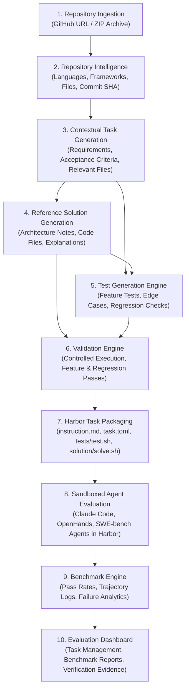

# 🏭 Coding Task Factory
## Master Project Alignment & Development Architecture
### Innodata AI Hackathon 2026 – Track 1: Coding Task Factory

---

## 🎯 1. Project Purpose

**Coding Task Factory** is an automated pipeline that converts real, working software repositories into realistic, solvable, and testable feature-development tasks designed to evaluate AI coding agents.

> **Core Philosophy**: Our goal is **NOT** simply to build an AI chatbot that answers coding questions or generates code snippets. Our goal is to build an automated, reusable factory that ingests production codebases and produces complete, reproducible task packages compatible with **[Harbor](https://harborframework.com/)** for sandboxed AI-agent benchmarking.

Every development decision in this repository strictly supports this objective.

---

## 📋 2. Actual Hackathon Problem Statement

The challenge establishes the following primary requirements:

1. **Supplied Repository & Task Interface**: Ground every task in a real codebase and conform to the standardized evaluation task interface.
2. **Reusable Generation Strategy**: Implement a single, robust, automated strategy for generating realistic feature-development tasks.
3. **Complete Task Package**: Every generated task package must contain:
   - Clear and achievable requirements.
   - A complete reference implementation.
   - Tests that verify the new feature.
   - Regression checks that protect existing functionality.
4. **Repository Version Tracking**: Every task package must record its exact starting repository version (commit SHA and repository snapshot).
5. **Standardized Task Interface**: Adhere strictly to the task interface specifications for agent evaluation.
6. **Ecosystem Compatibility**: Reference implementations and tests must work natively with the repository's:
   - Programming language.
   - Framework.
   - Dependencies.
   - Execution environment.
7. **Empirical Validation Evidence**: Retain concrete validation evidence demonstrating:
   - Implementations satisfy requirements.
   - Feature tests detect missing or incorrect behavior.
   - Regression checks protect existing functionality.

---

## 📊 3. Current Project Status & Milestone Progress

The backend is built with **FastAPI**, **Pydantic v2**, and **Google Gemini 3.8 Flash**.

```
Day 1: Foundation (FastAPI Scaffolding, Health Endpoints)            [COMPLETED]
Day 2: Modular Architecture (Routers, Schemas, Core Services)        [COMPLETED]
Day 3: Gemini Integration (Gemini 3.8 Flash, Topic Generation)       [COMPLETED]
Day 4: Repository Intelligence (SSRF Defense, Zip Security, Scanner) [COMPLETED]
Day 5: Contextual AI Task Generation (Grounding in Codebases)        [COMPLETED]
Day 6: Reference Solution Engine (Solution Schemas, Service & API)   [COMPLETED]
Day 7: Automated Test Generation & Harbor Alignment                  [IN PROGRESS]
```

### ✅ Completed Milestones:
- **Repository Intelligence**:
  - Secure GitHub repository download and safe ZIP extraction.
  - Deep SSRF defense (DNS resolution to public IPs only, blocking AWS metadata IP `169.254.169.254`, loopback, and private ranges).
  - Hardened ZIP security (Zip Slip traversal rejection, Windows drive/backslash checks, POSIX symlink detection, magic byte verification, decompression bomb prevention).
  - Recursive codebase scanner detecting languages, package managers, frameworks, and project structure without executing user code.
- **Contextual Task Generation**:
  - Grounded prompt engineering supplying file trees, detected frameworks, and README summaries to Gemini.
  - Generates realistic Jira/GitHub-style engineering tasks with requirements, acceptance criteria, and specific `relevant_files`.
- **Reference Solution Engine**:
  - `SolutionResponse` schema capturing architecture notes, file-level modifications/creations (`create` / `modify`), language, complete code, explanations, testing guides, and verification steps.
  - `POST /tasks/solution` API endpoint.
  - Deterministic generation (`temperature=0.2`) with prompt isolation guarding against prompt injection.
- **Test Suite Status**: **69 automated unit & integration tests** passing (100% mocked, zero API cost in CI/CD).
- **Live Verification**: End-to-end task generation and reference solution generation validated against the real Gemini API.

> ⚠️ **IMPORTANT TRANSPARENCY NOTE**: While task and reference solution *generation* are implemented and schema-validated, generated code has **NOT yet been executed inside a containerized repository sandbox**. That capability is tracked under the Validation Pipeline phase.

---

## 🔍 4. Identified Gaps – Must Be Addressed

To satisfy the full Hackathon challenge, the following gaps are being systematically resolved:

### A. Repository Version Tracking
- Record the original Git commit SHA when downloading from GitHub.
- Record repository identity and source.
- Preserve the starting repository snapshot or a deterministic mechanism to retrieve it.
- Prevent silent evaluation drift against mutable `HEAD`.

### B. Feature Test Generation
- Generate tests targeting the newly requested feature.
- Cover happy path, edge cases, invalid inputs, error handling, and 1:1 mapping to acceptance criteria.
- Design tests to fail when the feature is missing or incorrectly implemented.

### C. Regression Test Generation
- Generate or preserve checks verifying existing repository functionality remains unbroken after feature implementation.
- Maintain a strict distinction between feature tests and regression checks.

### D. Reference Solution Validation
- Do not accept solutions solely because Gemini produced valid JSON.
- Validate that solutions compile, align with repository dependencies, satisfy requirements, and pass both feature and regression tests in an isolated sandbox.

### E. Harbor Framework Integration
- Format generated tasks to be natively compatible with **[Harbor](https://harborframework.com/)**.
- Emit standard Harbor directory layouts (`instruction.md`, `task.toml`, `environment/Dockerfile`, `tests/test.sh`, `solution/solve.sh`).

### F. Validation Evidence
- Persist structured evidence: task ID, starting commit SHA, reference solution validation status, test logs, failure details, and evaluation rewards.

---

## 🏛️ 5. Target End-to-End Pipeline Architecture



---

## ⚓ 6. Harbor Framework Integration Standard

Harbor (`harborframework.com`) is an industry-standard framework for specifying sandboxed agent tasks. Every task package generated by Coding Task Factory will conform to the official Harbor task directory layout:

```text
<task-id>/
├── instruction.md         # The problem prompt & constraints shown to the AI agent
├── task.toml              # Harbor configuration (resource limits, timeouts, environment)
├── environment/           # Sandbox container specifications
│   └── Dockerfile         # Base image, dependencies, and repository starting snapshot
├── tests/                 # Automated verification logic
│   └── test.sh            # Verifier script (runs feature tests & regression checks, outputs reward)
└── solution/              # Canonical reference solution (oracle)
    └── solve.sh           # Script that applies the reference solution to prove solvability
```

### Key Harbor Components:
- **`instruction.md`**: Markdown problem statement detailing requirements, constraints, and instructions.
- **`task.toml`**: TOML configuration specifying timeout thresholds, container memory/CPU limits, and network policy.
- **`environment/Dockerfile`**: Self-contained container environment pinning language runtimes and dependencies from the starting repository commit.
- **`tests/test.sh`**: Hidden until agent completion. Executes test suites and returns deterministic rewards (1 = success, 0 = failure).
- **`solution/solve.sh`**: Automated reference implementation script used for oracle verification.

---

## 📡 7. API Endpoints

### 🩺 System & Health
| Method | Endpoint | Description |
|---|---|---|
| `GET` | `/` | Welcome and status message |
| `GET` | `/health` | Application health check (`{"status": "healthy"}`) |

### 🔍 Repository Intelligence
| Method | Endpoint | Description | Request Format |
|---|---|---|---|
| `POST` | `/tasks/analyze/github` | Ingests and analyzes a public GitHub repo | `{"repo_url": "https://github.com/owner/repo"}` |
| `POST` | `/tasks/analyze/upload` | Ingests and analyzes an uploaded `.zip` archive | `multipart/form-data` (`file: zip`) |

### 🎯 Contextual Task Generation
| Method | Endpoint | Description | Request Format |
|---|---|---|---|
| `POST` | `/tasks/generate` | Generates a topic-based task (legacy) | `{"topic": "...", "difficulty": "medium"}` |
| `POST` | `/tasks/generate/from-repo` | Generates task from existing `RepoAnalysisResponse` | `{"repo_analysis": {...}, "options": {...}}` |
| `POST` | `/tasks/generate/github` | Downloads repo, analyzes, and generates task | `{"repo_url": "...", "options": {...}}` |
| `POST` | `/tasks/generate/upload` | Uploads ZIP, analyzes, and generates task | `multipart/form-data` (`file: zip`, options) |

### 💡 Reference Solution Engine
| Method | Endpoint | Description | Request Format |
|---|---|---|---|
| `POST` | `/tasks/solution` | Generates full reference solution for a task | `{"task": <TaskResponse>}` |

### 🧪 Automated Test Generation *(Day 7 — In Progress)*
| Method | Endpoint | Description | Request Format |
|---|---|---|---|
| `POST` | `/tasks/tests` | Generates feature tests and regression checks | `{"task": <TaskResponse>, "solution": <Optional>}` |

---

## 🛡️ 8. Core Development Rules

1. **Follow the Hackathon Problem Statement**: Every feature must map directly to the challenge.
2. **Never Break Existing APIs**: Backward compatibility is strictly maintained across all schema and route enhancements.
3. **No Code Execution Without Isolation**: Never execute untrusted generated code or ingested repositories on the host machine.
4. **Treat Repository & Task Content as Untrusted Data**: Isolate user inputs and repository contents from prompt instructions to prevent prompt injection.
5. **Zero Secret Exposure**: Local API keys (`GEMINI_API_KEY`) are loaded from `backend/.env` and excluded from git, responses, and logs.
6. **Strict Mocking in CI/CD**: All unit and integration test suites use mocked Gemini and HTTP responses to guarantee zero API cost and deterministic tests.
7. **Empirical Validation**: Distinguish clearly between schema validation, mocked tests, real API generation, and real sandbox execution.
8. **No Commits Without Approval**: Changes are staged and reviewed before committing.

---

## 💻 9. Development Environment & Constraints

- **Operating System**: Windows 11
- **IDE**: Google Antigravity IDE
- **Python Runtime**: Python 3.14 (Virtual environment: `backend/.venv`)
- **AI Model**: Google Gemini 3.8 Flash (`google-genai` SDK)
- **Host Specs**: 8 GB RAM laptop (resource-conscious design, lazy loading, lightweight processes)
- **Container Environment**: Docker / WSL2 requirements evaluated for sandboxed execution without overloading host resources.

---

## 🗺️ 10. Updated Development Roadmap

### Phase 1 – Foundation & Task Generation *(Completed)*
- Backend scaffolding, health checks, modular architecture.
- Gemini API integration with `gemini-3.8-flash`.
- Repository intelligence engine (SSRF defense, ZIP security, scanner).
- Contextual task generation grounded in codebases.

### Phase 2 – Reference Solution Engine *(Completed)*
- Pydantic schemas for `SolutionResponse` and `SolutionFile`.
- Solution generation service (`temperature=0.2`).
- `POST /tasks/solution` endpoint with safe error mapping.
- 69 automated tests passing + live end-to-end verification.

### Phase 3 – Test Generation Engine *(Current)*
- Schemas for `TestSuiteRequest` and `TestSuiteResponse`.
- Feature tests: happy paths, edge cases, invalid inputs, error handling.
- Regression checks protecting pre-existing functionality.
- Acceptance criteria mapping.

### Phase 4 – Validation Pipeline
- Controlled workspace copies.
- Applying reference solutions to repositories.
- Executing feature and regression tests in isolated environments.
- Validation evidence collection and failure analysis.

### Phase 5 – Harbor Packaging
- Generating `instruction.md`, `task.toml`, `environment/Dockerfile`, `tests/test.sh`, and `solution/solve.sh`.
- Packaging validated tasks into official Harbor benchmarks.

### Phase 6 – AI Agent Evaluation & Benchmarking
- Evaluating coding agents (e.g. Claude Code, SWE-bench agents) against identical starting repositories.
- Pass/fail rate calculation and trajectory tracking (ATIF format).

### Phase 7 – Frontend Dashboard & Presentation
- Next.js + TypeScript dashboard.
- Task browser, validation evidence explorer, and benchmark comparison views.

---

## 🧪 11. Running the Automated Test Suite

From the `backend/` directory:

```powershell
# Run the complete test suite (69 tests)
.venv\Scripts\python.exe -m unittest discover -s tests -v
```

```text
Ran 69 tests in 1.868s
OK
```

### Test Suite Structure:
- `tests/test_solution_endpoint.py`: Endpoints tests for `POST /tasks/solution` (201, 422, 502, 503).
- `tests/test_solution_service.py`: Service tests for reference solution generation.
- `tests/test_solution_schemas.py`: Schema validation tests for solutions.
- `tests/test_contextual_task_endpoints.py`: Tests for `/tasks/generate/github`, `/upload`, `/from-repo`.
- `tests/test_task_service.py`: Topic-based and repo-based Gemini task generation tests.
- `tests/test_task_schemas.py`: Validation tests for task models.
- `tests/test_repo_ingestion.py`: Security tests (SSRF, Zip Slip, Symlinks, Bombs).
- `tests/test_repo_service.py`: Codebase scanner, framework, and language detection tests.
